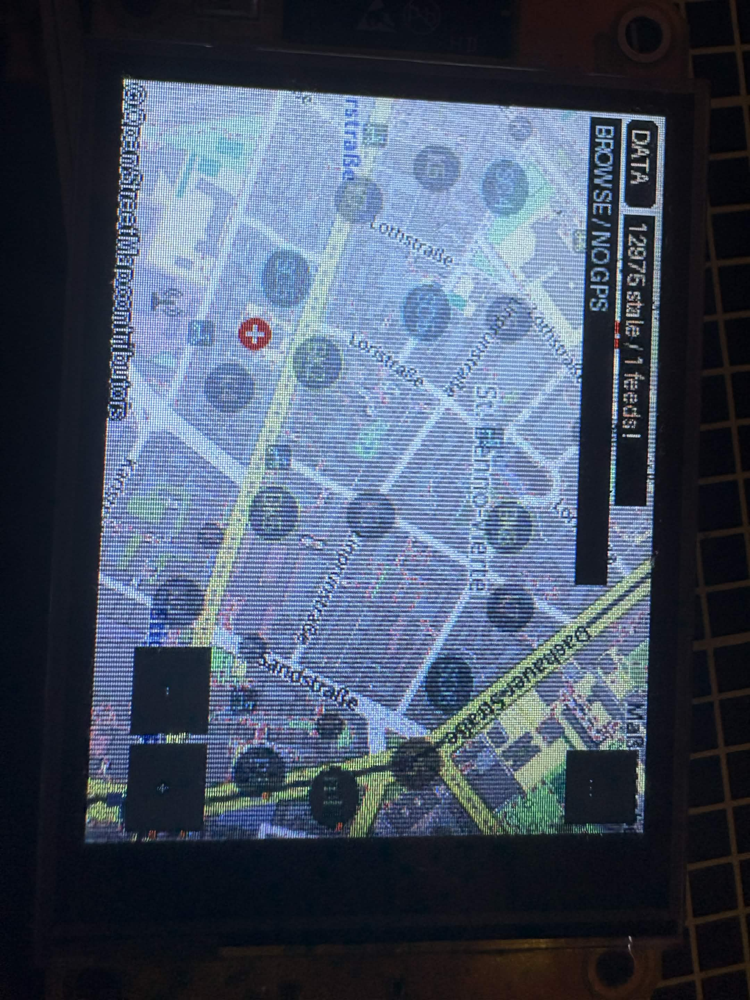
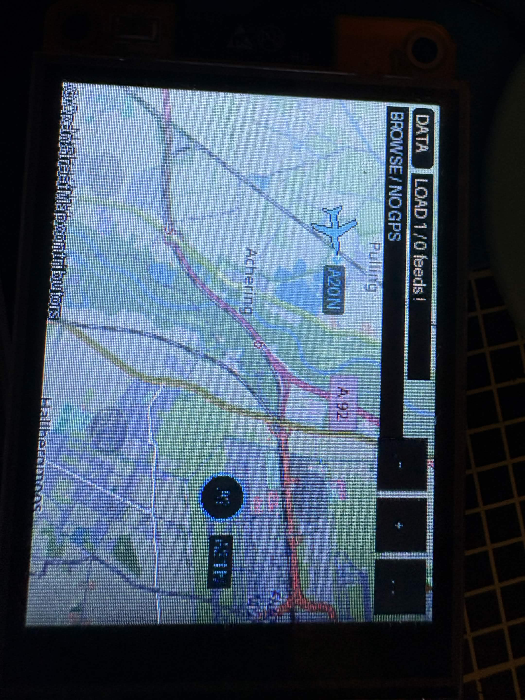
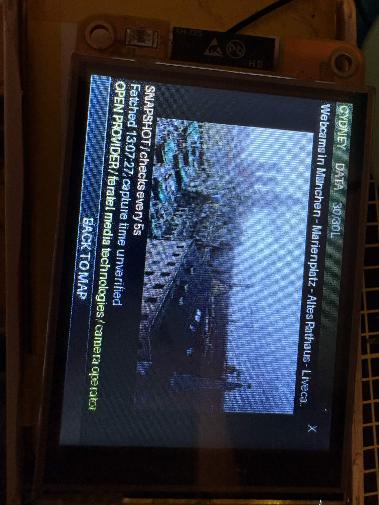
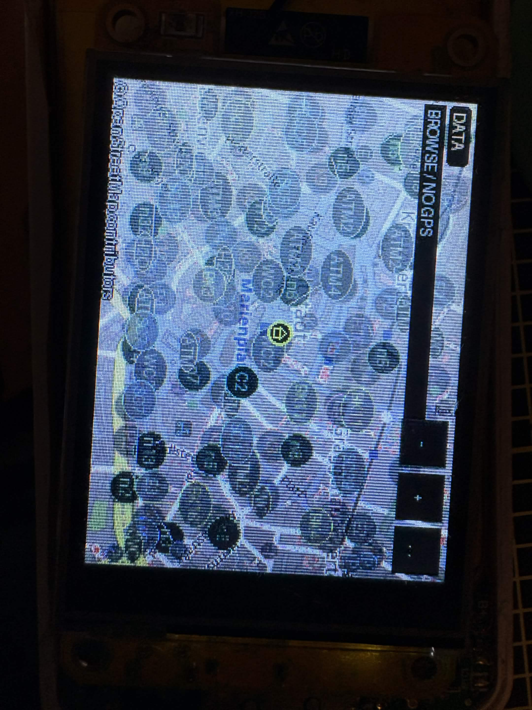
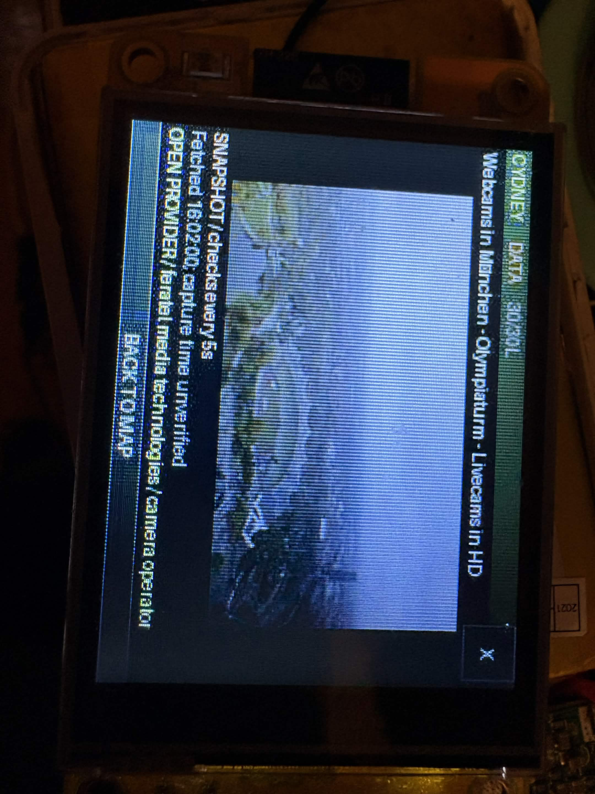
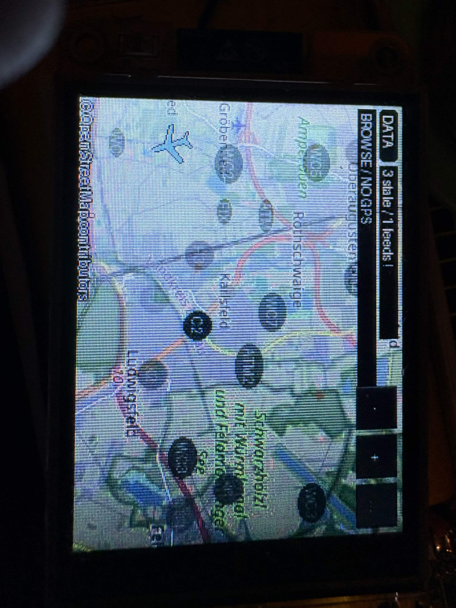
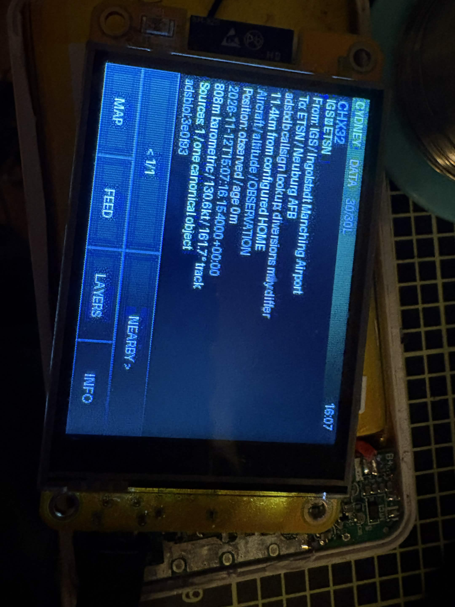
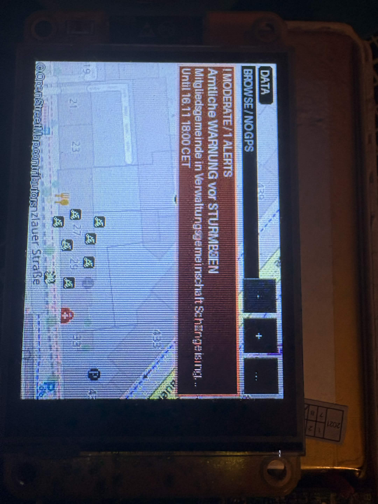

# cydney

Made for the popular CYD (cheap yellow display) to combine data aggregation with limited resources of embedded devices.
It's a small display showing you what is happening around you in real time. Built for the ESP32 **Cheap Yellow Display**, alongside a browser simulator to save me endless flashing.

Things included: map, (military) aircraft, helicopters, private jets, departures of any transit, shared bikes and scooters (popular in Munich), roadwork, weather, a lot of webcams I found and much more.
To make this SOMEWHAT clean we aggregate the same type of objects as clusters and only show one blob per cluster. Panning anywhere (even internationally) works, but this is specifically optimised for Munich.

Because the tiny ESP32 would struggle fetching that much data in real time, we combine it with a python backend that does most of the work, specifically data fetching and rendering to either **320 × 240** or **240 × 320**  (depending on your CYD). We use React to render it and then push it onto the CYD.

<p>
  
  
  
  <br>
  
  
  
  
</p>

## Run it

Should require **Python 3.12+**, [uv](https://docs.astral.sh/uv/) package manager, **Node.js 22.12+** and npm.

```sh
uv sync
npm ci
npm run build
npm run server
```

Open **http://127.0.0.1:8000**. For the default sources we do it completely without API keys.

- [Simulator](http://127.0.0.1:8000/)
- [Native-size display](http://127.0.0.1:8000/?device=1)
- [Portrait display](http://127.0.0.1:8000/?device=1&profile=portrait)
- [API docs](http://127.0.0.1:8000/api/docs)

Problem with panning around quickly is that the fetcher MIGHT not catch up in time, so be a little patient.

## Use it

- **Tap a marker** For example a camera, then you can see the live preview on your CYD. Tap an aircraft and it should show all available info.
- **Use my location** Using browser API to locate you, just for convenience.
- **Planned** includes future notices on the map. 

With the display focused:

| Key | Action |
| --- | --- |
| `C` | Controls |
| `V` | Cameras |
| `M` / `F` / `L` / `I` | Map / feed / layers / info |
| Arrow keys | Pan |
| `+` / `-` | Zoom |
| `G` | Enable browser location |
| `N` / `P` | Next / previous |
| `Esc` | Back to map |

You could start on some coords:

```text
http://127.0.0.1:8000/?lat=53.5511&lon=9.9937&zoom=14
```

## What's connected

| Source | What you get |
| --- | --- |
| OpenStreetMap / Overpass | basemap and a lot of public info already |
| ADSB.lol + adsbdb | Aircraft pos, direction, details etc |
| MVG | Munich subway, bus, for delay, stops etc |
| MVV GTFS | same |
| MyRadl / Dott | Available public to use bikes and scooters (at least those that provide a free api) |
| Munich open data | roadworks |
| DWD | weather |
| BBK / NINA | Munich warnings and affected areas |
| Public webcams | scraped from multiple sources |
| AllThePlaces | got some stores that OpenStreetMap doesn't etc. |
| Operator GTFS-Realtime | planned for bus/train location. |

I prioritized some things (aircraft, warnings, cameras etc, those are visible all the time, others become transparent to a certain degree on zooming)


## Configuration

All options are in [`.env.example`](.env.example). Careful: `npm run server` does NOT load `.env` by itself, you have to pass it:

```sh
cp .env.example .env
uv run uvicorn server.app:app --host 127.0.0.1 --port 8000 --env-file .env
```

### Cache Vars
those should be modified to your requirements. (you can not toggle this on the device itself).

| Variable | Purpose |
| --- | --- |
| `CYD_FEEDS=0` | 0 = cache only 1 = read feed |
| `CYD_TILES=0` | 0 = no map data read from osm 1 = read |
| `CYD_FEED_CACHE` | dir of the cache. default `.cache/feeds` |
| `CYD_ATP_FILE` | dir of [ATP](https://alltheplaces.xyz/) imports |
| `CYD_TRANSIT_VP_URL` / `CYD_TRANSIT_VP_ATTRIBUTION` | GTFS-RT vehicles (german trains, subways, etc) positions |
| `CYD_FEED_USER_AGENT` / `CYD_TILE_USER_AGENT` | user agent the CYD uses for HTTP commutation |

host on localhost ot server: [docs/cyd-and-vps.md](docs/cyd-and-vps.md). Authorization necessary against abuse.

## Architecture

python server -> doing the heavy work (fetching, caching, clustering) -> rendered -> (optionally compressed) JPEG/PNG/RGB565 -> browser and cyd are in sync (pos, zoom, display), use one to control the other. (browser should be optimally just used for developers)

### Directory structure
- [`server/`](server/) beckend, feeds, api, clustering
- [`web/`](web/) simulating the browser using playwright
- [`firmware/`](firmware/) ESP32 Code. basically just displaying the image 
- [`server/tests/`](server/tests/), [`tests/`](tests/) test dirs
- [`docs/`](docs/) notes on sources, cameras, flashing

API is documented here `/api/docs`.

## Tests

```sh
uv run pytest -q
npm test
npm run test:e2e
```

## Docs

- [data sources](docs/real-data.md)
- [live cameras and how to fetch](docs/camera-sources.md)
- [what is shown at which zoom](docs/display-policy.md)
- [flashing the CYD + VPS setup](docs/cyd-and-vps.md)
- [frame protocol](docs/website-prototype.md)

Map is [OpenStreetMap contributors](https://www.openstreetmap.org/) copyright. other licenses [here](docs/real-data.md#licenses).

## Notes

AI was used for parts of this, mostly the feed adapters, wifi setup on ESP32, some tests and general coding assistance.

## TODO:

- satellite imagery as alternative to OSM or even to find specially stuff with CV (this was one of my first ideas, turns out its not easy).
- fix train, subway, etc positions (MVG in Munich does not publish this)
- ships on the Isar, AIS for different cities
- Fix displaying german characters/Umlaute
- GPS module on the CYD so it can follow you (mine doesn't have one)
- listing cameras takes quite long, fetch parallel with timeout
- more cities (this was made mainly for munich for now)
- police or fire dispatches (only if legal sources exist)
- portrait mode on CYD (low priority)