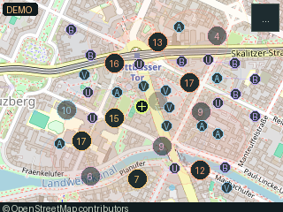

# Simulator and frame protocol

The browser simulator exists so I don't have to flash the ESP32 for every change. Python renders the frame (320 x 240 or 240 x 320), the browser just shows it and sends clicks back. The firmware uses the exact same API.



[3x](images/cyd-3x.png) · [card](images/cyd-object-card.png) · [menu](images/cyd-menu.png) · [layers](images/cyd-layers.png) · [portrait](images/cyd-portrait.png)

(the screenshots are from the old demo data in Berlin)

## Dev setup

```sh
uv sync
npm ci
npm run server   # terminal 1
npm run dev      # terminal 2, http://127.0.0.1:5173
```

`?device=1` shows only the frame in native size, `&profile=portrait` for portrait.

## Protocol

Create a session. With `shared: true` you attach to the same screen as the CYD:

```http
POST /api/device/sessions

{"profile":"landscape","shared":true}
```

Get a frame:

```http
GET /api/device/{id}/frame.jpg
GET /api/device/{id}/frame.png
GET /api/device/{id}/frame.rgb565?byte_order=big
```

RGB565 is raw, no header, 2 bytes per pixel, so 153600 bytes for one frame. JPEG/PNG support ETag so you get a 304 if nothing changed.

Send a touch, with the revision of the frame you are currently showing:

```http
POST /api/device/{id}/touch

{"x":120,"y":224,"revision":0}
```

If the revision is too old you get a 409, just fetch a new frame then. Add `?encoding=jpg` and the response is already the new frame.

Everything that is not a tap is an action:

```http
POST /api/device/{id}/action

{"kind":"pan","dx":40,"dy":0,"revision":1}
```

| kind | args |
| --- | --- |
| `pan` | `dx`, `dy` |
| `zoom` | `in` / `out`, optional `x`, `y` |
| `page` | `map/menu/feed/layers/info/cameras` |
| `camera` | camera id |
| `toggle` | layer id |
| `home` | |
| `next`, `prev` | |
| `select` | observation id |
| `dismiss` | closes the card |

## Memory on the ESP32

One raw frame is 150 KiB, that's already too much next to Wi-Fi + TLS without PSRAM. So the firmware gets the JPEG (max 48 KiB) and decodes it block by block straight onto the display.
